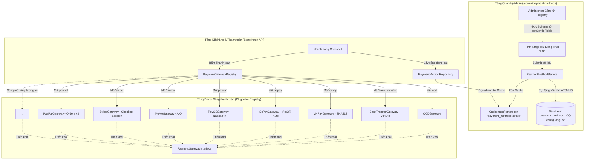

# 20 — Kiến trúc Cổng thanh toán Cắm - Rút (Pluggable Payment Gateway Architecture)

> Tài liệu kỹ thuật chi tiết về hệ thống cổng thanh toán dạng Module (Pluggable Driver Pattern) của Licuti CMS.
> Áp dụng từ tháng 10/2026.
> Thư mục mã nguồn: `app/Core/Payment/` | Provider: `app/Providers/PaymentServiceProvider.php`

---

## 1. Mục tiêu & Nguyên tắc Thiết kế (Design Principles)

Trong thương mại điện tử, các cổng thanh toán thường xuyên thay đổi API, chính sách và liên tục xuất hiện các dịch vụ thanh toán mới (VNPay, MoMo, ZaloPay, SePay, PayOS, Stripe, PayPal...).

Nếu lập trình theo lối truyền thống (hard-code `switch/case` trong Controller hoặc viết các khối `if ($method == 'vnpay')` rải rác):
- Mỗi lần thêm cổng mới phải sửa Controller, Service, Blade views, Database schema $\rightarrow$ Vi phạm trực tiếp nguyên tắc **Open/Closed (OCP)** trong SOLID.
- Dễ gây lỗi hồi quy (regression bugs) cho các cổng cũ đang hoạt động ổn định.

**Giải pháp của Licuti CMS — Kiến trúc Pluggable Registry:**
1. **Zero-Touch Core**: Thêm/bớt bất kỳ cổng thanh toán nào **chỉ cần tạo 1 file Driver Class và đăng ký 1 dòng code** tại ServiceProvider. Tuyệt đối không chỉnh sửa Controller, Checkout flow, hay Blade Views.
2. **Contract-First**: Mọi cổng thanh toán đều tuân thủ hợp đồng giao diện chuẩn [`PaymentGatewayInterface`](file:///c:/laragon/www/licuti-cms-laravel/app/Core/Payment/Contracts/PaymentGatewayInterface.php).
3. **Enterprise Security**: Mọi API Secret, Private Key, Token lưu trữ trong database đều được **tự động mã hóa AES-256**, ngăn chặn lộ credential khi rò rỉ database dump.
4. **Schema-Driven Form**: Mỗi Driver tự định nghĩa các trường cấu hình cần thiết qua `getConfigFields()`. Giao diện Admin tự động kết xuất (render) các ô nhập liệu tương ứng mà không cần code Blade thủ công.

---

## 2. Sơ đồ Kiến trúc Tổng thể (Architecture Diagram)



---

## 3. Các Thành phần Cốt lõi (Core Components)

### 3.1. Hợp đồng Giao diện: `PaymentGatewayInterface`
Đặt tại [`app/Core/Payment/Contracts/PaymentGatewayInterface.php`](file:///c:/laragon/www/licuti-cms-laravel/app/Core/Payment/Contracts/PaymentGatewayInterface.php).

```php
interface PaymentGatewayInterface
{
    public function getCode(): string;
    public function getName(): string;
    public function getDescription(): string;
    public function setConfig(array $config): static;
    public function getConfig(?string $key = null, mixed $default = null): mixed;
    public function getConfigFields(): array;
    public function charge(object $order, array $paymentData = []): PaymentResult;
    public function refund(object $payment, float $amount): RefundResult;
    public function handleWebhook(Request $request): PaymentResult;
}
```

### 3.2. Lớp cơ sở: `AbstractPaymentGateway`
Đặt tại [`app/Core/Payment/Gateways/AbstractPaymentGateway.php`](file:///c:/laragon/www/licuti-cms-laravel/app/Core/Payment/Gateways/AbstractPaymentGateway.php).
Cung cấp sẵn các logic mặc định:
- Lưu trữ và truy xuất mảng cấu hình qua helper `Arr::get()`.
- Triển khai mặc định các hàm an toàn cho `refund()`, `handleWebhook()`, `getDescription()`, `getConfigFields()`.

### 3.3. DTO Chuẩn hóa: `PaymentResult` & `RefundResult`
Đặt tại `app/Core/Payment/DTOs/`.
- `PaymentResult`:
  - `status`: `success` | `pending` | `failed`.
  - `transactionId`: Mã giao dịch từ cổng đối tác.
  - `redirectUrl`: Đường dẫn redirect sang cổng thanh toán (nếu là cổng chuyển hướng).
  - `isSuccess()`, `isPending()`, `isFailed()`, `isSuccessful()`, `isRedirect()`.
  - `rawData`: Toàn bộ payload trả về từ cổng để đối soát hoặc lưu audit log.

### 3.4. Hệ thống Quản lý Đăng ký: `PaymentGatewayRegistry`
Đặt tại [`app/Core/Payment/PaymentGatewayRegistry.php`](file:///c:/laragon/www/licuti-cms-laravel/app/Core/Payment/PaymentGatewayRegistry.php).
- Được đăng ký dạng **Singleton** trong Service Container.
- Cung cấp các phương thức quản lý:
  - `register(string $code, string|PaymentGatewayInterface $gateway)`: Đăng ký driver.
  - `get(string $code, array $config = []): ?PaymentGatewayInterface`: Khởi tạo bản sao độc lập (isolated clone) của driver kèm nạp thông số cấu hình.
  - `has(string $code): bool`: Kiểm tra cổng đã đăng ký chưa.
  - `getOptions(): array`: Danh sách [code => Tên cổng] phục vụ dropdown Admin.
  - `getAllConfigSchemas(): array`: Xuất toàn bộ schema cấu hình cho giao diện Admin.

---

## 4. Bảo mật Cấu hình (AES-256 Transparent Encryption)

Cột `config` trong bảng `payment_methods` chứa các thông tin nhạy cảm:
- Khóa bí mật API: `secret_key`, `hash_secret`, `checksum_key`.
- Tài khoản ngân hàng, thông tin xác thực Merchant.

### Cơ chế hoạt động trong Model `PaymentMethod`:
1. **Khi ghi (Mutator `setConfigAttribute`)**:
   Dữ liệu mảng PHP hoặc JSON được mã hóa bằng `Crypt::encryptString(json_encode($array))` trước khi lưu vào cột `longText`. Trong database là chuỗi ciphertext được gắn kèm mã MAC bảo đảm tính toàn vẹn.
2. **Khi đọc (Accessor `getConfigAttribute`)**:
   Tự động giải mã qua `Crypt::decryptString($value)`.
3. **Khả năng tương thích ngược (Backward Compatibility)**:
   Nếu bản ghi cũ trong database chứa JSON thô (plaintext), phương thức tự động bắt `DecryptException` và giải mã bằng `json_decode`, không bao giờ gây gián đoạn hệ thống. Khi bản ghi được lưu lại, nó sẽ tự động chuyển sang dạng mã hóa AES-256.

---

## 5. Danh mục 8 Cổng Thanh toán Mặc định

Hệ thống đã triển khai đầy đủ 8 cổng nội địa và quốc tế:

| Mã cổng (`code`) | Tên cổng | Driver Class | Đặc điểm kỹ thuật nổi bật |
|---|---|---|---|
| `cod` | Tiền mặt khi nhận hàng | `CODGateway` | Tùy chọn kiểm hàng đồng kiểm, ghi chú cho shipper. |
| `bank_transfer` | Chuyển khoản (VietQR Tĩnh) | `BankTransferGateway` | Sinh mã VietQR tĩnh theo số tài khoản, tên ngân hàng và mã đơn. |
| `vnpay` | Cổng VNPAY | `VNPayGateway` | Tính toán chuỗi chữ ký HMAC-SHA512 bảo mật; URL Sandbox/Production; Webhook IPN checksum. |
| `sepay` | SePay (VietQR Tự động) | `SePayGateway` | Sinh link VietQR SePay; xác thực Webhook biến động số dư qua Authorization Apikey. |
| `payos` | PayOS (Napas247) | `PayOSGateway` | Tạo link thanh toán động qua PayOS API; xác thực chữ ký Webhook HMAC-SHA256 với `checksum_key`. |
| `momo` | Ví MoMo | `MoMoGateway` | Chuẩn All-In-One (AIO) QR & App redirect; xác thực chữ ký IPN HMAC-SHA256. |
| `stripe` | Thẻ quốc tế Stripe | `StripeGateway` | Stripe Hosted Checkout Session; tự nhận diện tiền tệ zero-decimal (VND/USD/EUR/JPY); Webhook header `Stripe-Signature`. |
| `paypal` | Ví PayPal Quốc Tế | `PayPalGateway` | PayPal Checkout v2 Orders API; tự động quy đổi tỷ giá VND sang USD; bắt Webhook `PAYMENT.CAPTURE.COMPLETED`. |

---

## 6. Hướng dẫn Thêm Cổng Thanh toán Mới (Step-by-step Tutorial)

Ví dụ: Bạn muốn tích hợp thêm cổng thanh toán **ZaloPay**.

### Bước 1: Tạo file Gateway Driver
Tạo file `app/Core/Payment/Gateways/ZaloPayGateway.php`:

```php
<?php

namespace App\Core\Payment\Gateways;

use App\Core\Payment\DTOs\PaymentResult;
use Illuminate\Http\Request;
use Illuminate\Support\Facades\Http;

class ZaloPayGateway extends AbstractPaymentGateway
{
    public function getCode(): string
    {
        return 'zalopay';
    }

    public function getName(): string
    {
        return __('Ví điện tử ZaloPay');
    }

    public function getDescription(): string
    {
        return __('Thanh toán qua ví điện tử ZaloPay hoặc quét mã ZaloPay QR.');
    }

    public function getConfigFields(): array
    {
        return [
            'app_id' => [
                'type'        => 'text',
                'label'       => __('App ID'),
                'placeholder' => 'Ví dụ: 2553',
                'required'    => true,
            ],
            'key1' => [
                'type'        => 'password',
                'label'       => __('Key 1 (Tạo đơn hàng)'),
                'required'    => true,
            ],
            'key2' => [
                'type'        => 'password',
                'label'       => __('Key 2 (Xác thực Callback Webhook)'),
                'required'    => true,
            ],
        ];
    }

    public function charge(object $order, array $paymentData = []): PaymentResult
    {
        // 1. Lấy thông số cấu hình đã được giải mã tự động
        $appId = $this->getConfig('app_id');
        $key1  = $this->getConfig('key1');

        // 2. Chuẩn bị payload và tạo chữ ký HMAC theo tài liệu ZaloPay
        // ...

        // 3. Trả về kết quả
        return PaymentResult::pending(
            transactionId: 'ZP-' . $order->order_number,
            redirectUrl: 'https://gateway.zalopay.vn/...',
            message: __('Chuyển hướng đến cổng thanh toán ZaloPay...')
        );
    }

    public function handleWebhook(Request $request): PaymentResult
    {
        $key2 = $this->getConfig('key2');
        // Kiểm tra chữ ký MAC từ ZaloPay gửi về
        // ...
        return PaymentResult::success(
            transactionId: (string) $request->input('app_trans_id'),
            message: __('Thanh toán ZaloPay thành công.')
        );
    }
}
```

### Bước 2: Đăng ký tại `PaymentServiceProvider`
Mở [`app/Providers/PaymentServiceProvider.php`](file:///c:/laragon/www/licuti-cms-laravel/app/Providers/PaymentServiceProvider.php) và thêm:

```php
$registry->register('zalopay', \App\Core\Payment\Gateways\ZaloPayGateway::class);
```

**Hoàn tất!**
- Giao diện Admin (`/admin/payment-methods/create`) sẽ lập tức có tùy chọn ZaloPay và tự sinh form nhập `App ID`, `Key 1`, `Key 2`.
- Khi khách đặt hàng, `PaymentGatewayRegistry::get('zalopay')` sẽ tự động thực thi logic thanh toán của ZaloPay.
