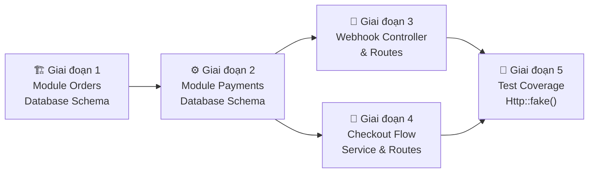

# 🗺️ Kế hoạch Phát triển Tiếp theo — Licuti CMS

> **Trạng thái hiện tại (13/10/2026):** Module PaymentMethod ✅ hoàn chỉnh ở tầng Infrastructure.
> Cần "đóng vòng" để giao dịch thanh toán vận hành thực tế end-to-end.

---

## Tổng quan Thứ tự Phụ thuộc



> [!IMPORTANT]
> Phải thực hiện theo thứ tự từ Giai đoạn 1 → 5. Giai đoạn 3 và 4 có thể làm song song sau Giai đoạn 2.

---

## Giai đoạn 1 — 🏗️ Module Orders (Database Schema)

**Phụ thuộc:** Không có (có thể bắt đầu ngay)
**Ước lượng:** ~3–4h

### Hiện trạng
- [`app/Models/Order.php`](file:///c:/laragon/www/licuti-cms-laravel/app/Models/Order.php) — shell 12 dòng, dùng `$guarded = []` (vi phạm AGENTS.md)
- [`database/migrations/2026_08_15_130959_create_orders_table.php`](file:///c:/laragon/www/licuti-cms-laravel/database/migrations/2026_08_15_130959_create_orders_table.php) — chỉ có `id` + `timestamps`
- [`app/Services/Admin/Order/OrderService.php`](file:///c:/laragon/www/licuti-cms-laravel/app/Services/Admin/Order/OrderService.php) — stub cơ bản, chưa có logic nghiệp vụ
- [`app/DTOs/Order/OrderDTO.php`](file:///c:/laragon/www/licuti-cms-laravel/app/DTOs/Order/OrderDTO.php) — quá generic, không có typed properties

### Các Task cần làm

#### Task 1.1 — Tạo Enum `OrderStatus`
```
app/Enums/OrderStatus.php
```
Các trạng thái: `PENDING`, `PROCESSING`, `CONFIRMED`, `SHIPPING`, `DELIVERED`, `COMPLETED`, `CANCELLED`, `REFUNDED`

#### Task 1.2 — Migration: Nâng cấp bảng `orders`
```
database/migrations/2026_10_13_000001_enhance_orders_table.php
```
Các cột cần thêm:
- `uuid` (unique)
- `order_number` (unique, ví dụ `ORD-20261013-00001`)
- `user_id` (FK → users, nullable — cho phép guest checkout)
- `payment_method_id` (FK → payment_methods)
- `status` (enum `OrderStatus`, default PENDING)
- `subtotal`, `discount_amount`, `shipping_fee`, `tax_amount`, `total_amount` (decimal 15,2)
- `currency` (varchar 3, default 'VND')
- `notes` (text, nullable)
- `cancel_reason` (text, nullable)
- `paid_at` (timestamp, nullable)
- `shipped_at` (timestamp, nullable)
- `completed_at` (timestamp, nullable)
- `cancelled_at` (timestamp, nullable)

#### Task 1.3 — Migration: Tạo bảng `shipping_addresses`
```
database/migrations/2026_10_13_000002_create_shipping_addresses_table.php
```
Các cột: `id`, `uuid`, `order_id` (FK), `recipient_name`, `phone`, `email`, `address_line`, `ward`, `district`, `province`, `country` (default VN), `zip_code`, `timestamps`

#### Task 1.4 — Migration: Tạo bảng `order_items`
```
database/migrations/2026_10_13_000003_create_order_items_table.php
```
Các cột: `id`, `uuid`, `order_id` (FK), `product_id` (FK, nullable), `product_variant_id` (FK, nullable), `product_name` (snapshot), `product_sku` (snapshot), `unit_price`, `quantity`, `discount_amount`, `subtotal`, `meta` (json), `timestamps`

#### Task 1.5 — Migration: Tạo bảng `order_status_histories`
```
database/migrations/2026_10_13_000004_create_order_status_histories_table.php
```
Các cột: `id`, `order_id` (FK), `from_status` (nullable), `to_status`, `note` (text), `changed_by_user_id` (FK → users, nullable), `timestamps`

#### Task 1.6 — Nâng cấp `Order` Model
- Thêm trait `HasUuid`, `HasFactory`, `SoftDeletes`
- Dùng `$fillable` thay `$guarded = []`
- Cast `status` → `OrderStatus::class`
- Quan hệ: `user()`, `paymentMethod()`, `shippingAddress()`, `items()`, `statusHistories()`, `payments()`
- Scopes: `scopePending()`, `scopeCompleted()`, `scopeCancelled()`
- Helper: `markAsPaid()`, `cancel(string $reason)`

#### Task 1.7 — Tạo Models phụ trợ
- `app/Models/OrderItem.php`
- `app/Models/ShippingAddress.php`
- `app/Models/OrderStatusHistory.php`

#### Task 1.8 — Nâng cấp DTO + Service
- `OrderDTO` — typed properties: `userId`, `paymentMethodId`, `items[]`, `shippingAddress`, `notes`
- `OrderService::create()` — dùng `DB::transaction()`, tạo `order_items`, record `order_status_histories`
- `OrderRepository` — thêm `findByOrderNumber()`, `getByStatus()`, `getPaginatedWithRelations()`

#### Task 1.9 — Nâng cấp Admin Views
- `index.blade.php` — bảng hiển thị mã đơn, khách hàng, trạng thái (badge màu), tổng tiền, ngày tạo
- `form.blade.php` — layout 2 cột chuẩn, hiển thị thông tin đơn hàng + items table + timeline trạng thái
- Thêm trang `show.blade.php` — chi tiết đơn hàng (readonly, cho Admin xem)

#### Task 1.10 — Tests
- `tests/Feature/Admin/OrderCrudTest.php`

---

## Giai đoạn 2 — ⚙️ Module Payments (Database Schema)

**Phụ thuộc:** Giai đoạn 1
**Ước lượng:** ~2–3h

### Hiện trạng
- [`database/migrations/2026_08_15_131001_create_payments_table.php`](file:///c:/laragon/www/licuti-cms-laravel/database/migrations/2026_08_15_131001_create_payments_table.php) — shell, chỉ `id` + `timestamps`

### Các Task cần làm

#### Task 2.1 — Enum `PaymentStatus`
Các trạng thái: `PENDING`, `PROCESSING`, `SUCCESS`, `FAILED`, `REFUNDED`, `CANCELLED`

#### Task 2.2 — Migration: Nâng cấp bảng `payments`
```
database/migrations/2026_10_13_000005_enhance_payments_table.php
```
Các cột:
- `uuid` (unique)
- `order_id` (FK → orders)
- `payment_method_id` (FK → payment_methods)
- `gateway_code` (varchar 30, ví dụ `'vnpay'`, `'momo'`)
- `gateway_transaction_id` (varchar, nullable — ID giao dịch từ cổng thanh toán) — **unique để idempotency**
- `status` (enum `PaymentStatus`, default PENDING)
- `amount` (decimal 15,2)
- `currency` (varchar 3, default 'VND')
- `gateway_response` (json, nullable — raw response từ cổng)
- `paid_at` (timestamp, nullable)
- Index: unique composite `(order_id, gateway_transaction_id)` — phòng double processing

#### Task 2.3 — Model `Payment`
- Trait `HasUuid`
- `$fillable`, cast `status` → `PaymentStatus::class`
- Quan hệ: `order()`, `paymentMethod()`
- Helper: `markAsSuccess(string $gatewayTransactionId)`

#### Task 2.4 — `PaymentRepository` + `PaymentService`
- `findByGatewayTransactionId()` — dùng cho idempotency check trong Webhook
- `createFromGatewayResult(Order $order, PaymentResult $result)` — tạo bản ghi payment từ kết quả gateway

---

## Giai đoạn 3 — 🔗 Webhook Controller

**Phụ thuộc:** Giai đoạn 1 + 2
**Ước lượng:** ~3–4h

### Mục tiêu
Nhận callback từ 5 cổng có Webhook: **SePay, PayOS, MoMo, Stripe, PayPal** → xác thực chữ ký → cập nhật trạng thái đơn hàng & payment.

### Các Task cần làm

#### Task 3.1 — Route Webhook
```php
// routes/api.php
Route::post('/v1/payments/webhook/{gateway}', PaymentWebhookController::class)
    ->name('api.v1.payments.webhook');
```
> [!CAUTION]
> Route này KHÔNG có `auth:sanctum` middleware. Phải xác thực chữ ký ở tầng Controller/Gateway.

#### Task 3.2 — `PaymentWebhookController`
```
app/Http/Controllers/Api/Payment/PaymentWebhookController.php
```
Logic:
1. Tìm driver qua `PaymentGatewayRegistry::get($gateway)` — 404 nếu không tồn tại
2. Load config từ `PaymentMethod::where('code', $gateway)->active()->first()`
3. Gọi `$driver->setConfig($config)->handleWebhook($request)` → `PaymentResult`
4. **Idempotency check**: Kiểm tra `gateway_transaction_id` đã tồn tại trong bảng `payments` chưa
5. Nếu chưa: Tạo record `Payment`, cập nhật `Order::status`, ghi `OrderStatusHistory`
6. Fire event `PaymentSucceeded` / `PaymentFailed`
7. Trả về HTTP 200 (dù thành công hay fail — tránh cổng gửi lại)

#### Task 3.3 — Events & Listeners
- `app/Events/Payment/PaymentSucceeded.php`
- `app/Events/Payment/PaymentFailed.php`
- `app/Listeners/Payment/UpdateOrderStatusOnPayment.php` (ShouldQueue)
- `app/Listeners/Payment/SendOrderConfirmationNotification.php` (ShouldQueue, gửi email)

#### Task 3.4 — Webhook Test
```
tests/Feature/Api/PaymentWebhookTest.php
```
Test cho từng cổng: SePay, PayOS, MoMo, Stripe, PayPal (dùng `Http::fake()` + mock signature)

---

## Giai đoạn 4 — 🛒 Checkout Flow

**Phụ thuộc:** Giai đoạn 1 + 2
**Ước lượng:** ~4–5h

> [!NOTE]
> Đây là "Frontend API" cho khách hàng, không phải Admin. Nằm trong `routes/api.php` hoặc `routes/web.php` tuỳ kiến trúc frontend.

### Các Task cần làm

#### Task 4.1 — `CheckoutService`
```
app/Services/Checkout/CheckoutService.php
```
Methods:
- `initiateCheckout(CheckoutDTO $dto): PaymentResult` — tạo Order + gọi gateway `charge()`
- `handleReturn(string $gateway, Request $request): PaymentResult` — xử lý user quay lại sau thanh toán

#### Task 4.2 — `CheckoutDTO`
```
app/DTOs/Checkout/CheckoutDTO.php
```
Properties: `userId`, `cartItems[]`, `shippingAddress`, `paymentMethodCode`, `couponCode`, `notes`

#### Task 4.3 — `CheckoutController` (API)
```
app/Http/Controllers/Api/CheckoutController.php
```
- `POST /api/v1/checkout` → tạo đơn hàng, trả về `redirect_url` hoặc `qr_code`
- `GET /api/v1/checkout/return/{gateway}` → xử lý return URL (VNPay, PayPal redirect flow)

#### Task 4.4 — Return URL Routes
```php
Route::get('/checkout/return/{gateway}', [CheckoutController::class, 'handleReturn'])
    ->name('checkout.return');
```

#### Task 4.5 — Tests Checkout
```
tests/Feature/Api/CheckoutTest.php
```

---

## Giai đoạn 5 — 🧪 Fix Unit Tests

**Phụ thuộc:** Có thể làm độc lập ngay bây giờ
**Ước lượng:** ~1h

### Vấn đề
[`tests/Unit/Payment/PaymentGatewayRegistryTest.php`](file:///c:/laragon/www/licuti-cms-laravel/tests/Unit/Payment/PaymentGatewayRegistryTest.php) — test cho `PayOSGateway::charge()` và `MoMoGateway::charge()` đang gọi `Http::post()` thật → fail khi không có internet.

### Các Task cần làm

#### Task 5.1 — Thêm `Http::fake()` cho PayOS `charge()`
Trong test, mock response PayOS API:
```php
Http::fake([
    'api.payos.vn/*' => Http::response([
        'code' => '00',
        'data' => ['checkoutUrl' => 'https://pay.payos.vn/web/abc123']
    ], 200),
]);
```

#### Task 5.2 — Thêm `Http::fake()` cho MoMo `charge()`
```php
Http::fake([
    '*.momo.vn/*' => Http::response([
        'resultCode' => 0,
        'orderId' => 'TEST_ORDER_001',
        'payUrl' => 'https://payment.momo.vn/redirect?token=abc',
    ], 200),
]);
```

#### Task 5.3 — Thêm `Http::fake()` cho PayPal OAuth2 token call
PayPal driver gọi `Http::post()` để lấy OAuth2 token và tạo order — cần fake cả 2 calls.

---

## Bảng Tổng hợp Workload

| Giai đoạn | Nội dung | Files cần tạo/sửa | Ước lượng |
|---|---|---|---|
| 1 | Module Orders Schema | 4 migration + 4 model + 2 DTO/Service + 2 view + 1 test | ~3–4h |
| 2 | Module Payments Schema | 1 migration + 1 model + 1 repo + 1 service + 2 enum | ~2–3h |
| 3 | Webhook Controller | 1 controller + 1 route + 2 event + 2 listener + 1 test | ~3–4h |
| 4 | Checkout Flow | 1 service + 1 DTO + 1 controller + 2 route + 1 test | ~4–5h |
| 5 | Fix Unit Tests | 1 file test (sửa) | ~1h |
| **Tổng** | | **~25 files** | **~13–17h** |

---

## Lưu ý Kỹ thuật Quan trọng

> [!WARNING]
> **Idempotency Webhook** — Cổng SePay/PayOS/MoMo có thể gửi cùng 1 webhook nhiều lần. Bắt buộc kiểm tra `gateway_transaction_id` đã tồn tại trong bảng `payments` trước khi xử lý để tránh tạo đơn trùng / credit tiền 2 lần.

> [!WARNING]
> **Snapshot giá sản phẩm** — Khi tạo `order_items`, phải snapshot `product_name`, `product_sku`, `unit_price` tại thời điểm đặt hàng vào bảng `order_items`. KHÔNG dùng FK reference để query giá sau này (giá có thể thay đổi).

> [!TIP]
> **Guest Checkout** — `orders.user_id` là nullable để hỗ trợ khách không đăng nhập. Thông tin liên lạc lưu trong `shipping_addresses`.

> [!NOTE]
> **Thứ tự build tiếp theo theo AGENTS.md**: Tầng 5 (Cart/Coupon) nên được hoàn thiện trước hoặc song song với Tầng 6 (Orders) để `CheckoutService` có thể tính tổng giỏ hàng và áp mã giảm giá đúng.
